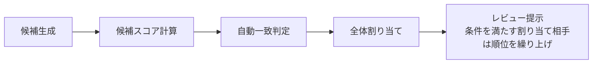

# 端末内の明細照合

## 照合エンジンの流れ

候補は前後7日以内・金額差が `max(100円, 明細金額の3%)` 以内で生成します。スコアは以下の各成分を加重して合算し、小数点以下6桁に丸めます。

| スコア | 金額 | 日付 | 店名 | 支払元 |
| --- | --- | --- | --- | --- |
| レビュー | 0.55 | 0.15 | 0.05 | 0.25 |
| 自動一致 | 0.55 | 0.25 | 0.20 | 対象外 |

- 金額スコア: 金額完全一致なら `1`、それ以外は `max(0, 1 - 金額差 / max(100円, 明細金額の3%))`。
- 日付スコア: `1 - 日付差（日） / (候補日付幅 + 1)`。現在の候補日付幅は7日。
- 店名スコア: 店名を正規化し、文字 bigram の Sørensen–Dice 類似度（0〜1）を使います。登録済みaliasに一致した場合は1です。レビュー用と自動一致用で正規化処理が異なります。
- 支払元スコア: 現在の設定上の支払元が明細サービスに対応する場合に1、そうでなければ0です。過去の取込に保存された支払元は使いません。

### 自動一致の条件

返金は自動一致の対象外です。購入明細と支出の候補ペアは、以下をすべて満たす場合に自動一致します。

- 金額が完全一致する。
- 日付差が2日以内。
- 店名類似度が0.72以上、または登録済みaliasに一致する。
- 自動一致スコアが0.88以上。
- 明細側と支出側の双方で相互に1位である。
- 明細側・支出側の双方で、1位と次点の自動一致スコア差が0.15以上。
- 明細が人手で判断済みとして指定されていない。

版数1.2.3以降は、支払元が一致し、金額が完全一致し、明細の利用日・支出の購入日をそれぞれ中心とする候補日付幅（±7日）内の同額件数が、全入力で双方とも1件の場合に限り、自動一致スコア計算で店名類似度を1として扱います。一意性は除外・拒否の適用前に数え、明細側は purchase のみを対象とします。そのため、除外・拒否後の候補が1件でも、全入力に同額競合があれば waiver は発動しません。この waiver は通常の店名類似度ゲートを免除しますが、残りの自動一致条件は引き続き必要です。

自動一致を確定した後、未確定の候補で最大重みの全体割り当てを計算します。割り当て相手が通常の上位3候補に含まれ、1位とのレビュー用スコア差が0.15以内の場合だけ、その相手を1位へ繰り上げます。候補集合と自動一致結果は変更しません。

### コストモデルと三値決定

現行エンジンは「自動一致／要確認／不一致」の三つに判定します。[TypeScript実装](../src/lib/reconciliation-engine.ts#L498-L512) Chow の最適棄却規則は分類誤りと棄却のトレードオフを扱います。[Chow (1970/01), pp. 41–46](https://doi.org/10.1109/TIT.1970.1054406) Fellegi–Sunter の record linkage は、link／possible link／non-link の三つの判断を定義します。[Fellegi–Sunter (1969/12), pp. 1183–1210](https://doi.org/10.1080/01621459.1969.10501049) したがって、現行の三値決定は判断の構造として両者と同型です。この対応は現行エンジンが事後確率や Fellegi–Sunter の尤度比を計算すること、また誤り率を保証することを意味しません。

この設計では、明細または候補ペアについて、次の相対コストを置きます。値は**実測ではなく設計の置き値**です。

| コスト | 定義 | 置き値 |
| --- | --- | ---: |
| 誤自動一致（`C_FA`） | 別取引を一致として確定し、本来確認すべき明細を隠す損失。誤った台帳状態の修正や、不正取引を見えなくする影響を含む | 100 |
| 見逃し（`C_miss`） | 本来正しい一致だが自動一致にならず、要確認または不一致に回ることで自動化できなかった機会損失 | 2 |
| 要確認（`C_review`） | 候補と明細を人が確認し、判断を確定する作業負担 | 1 |

提案する比は **誤自動一致：見逃し：要確認＝100：2：1** です。不正取引の発見を目的とするため、誤った自動一致を、レビューで回復できる自動化の取りこぼしや一件の確認作業より重く置きます。見逃しは自動化できなかった機会損失、要確認は人の確認作業として分けます。正しい一致が要確認になった場合は、見逃しコスト2と確認コスト1の両方が発生する設計です。この比は「誤自動一致1件を確認100件分とみなす」という業務上の置き値であり、データから推定した換算ではありません。

現行のスコアは手設計の加重値であり確率ではありません。そのため、このコスト比から `0.72`、`0.15`、`0.88` などの閾値を導いたとは説明しません。以下の対応表はコード上の条件と、それが抑えるコストの**設計上の解釈**です。閾値ごとの効果量を測定した結果ではありません。[TypeScript実装](../src/lib/reconciliation-engine.ts#L8-L25) [Swift実装](../apps/ios/KakeiMatch/Data/Reconciliation/ReconciliationEngine.swift#L12-L22)

| 現行条件 | 主に抑えるコストと副作用 | コスト上の解釈 |
| --- | --- | --- |
| 候補日付窓は明細日から前後7日以内 | 窓外の誤候補と要確認負担を抑える。窓外の正しい一致は見逃しになる | 候補探索の範囲であり、7日に統計的な誤り率の根拠があるとは確認されていない |
| 候補金額差は `max(100円, 明細金額の3%)` 以内 | 許容差外の誤候補と要確認負担を抑える。許容差外の正しい一致は見逃しになる | 候補を作る条件。100円と3%はコスト比から較正されていない |
| 自動一致は金額完全一致 | 誤自動一致を抑える | 端数や調整を含む正しい一致も自動化せず、見逃しまたは要確認側へ送る |
| 自動一致は日付差2日以内 | 日付の離れた別取引による誤自動一致を抑える | 2日を超える正しい一致は自動化しない。候補窓内なら要確認になり得る |
| 自動店名類似度 `>= 0.72` または登録済みalias | 店名の弱い一致による誤自動一致を抑える | 閾値未満の正しい一致も自動化しない。誤ったaliasは誤自動一致につながり得る |
| waiver：支払元が一致し、金額完全一致で、明細・レシート双方の±7日以内に同額の相手が全入力で各1件 | 店名が弱い組の誤自動一致を、支払元と両側の金額一意性で抑える設計 | 一意性は除外・拒否の適用前に数え、明細側は購入のみ。成立すると店名類似度を1として通常の店名ゲートを免除するため、日付・スコア・両側marginなどの条件は残る。通常経路とは分けてリスクを見る |
| `autoScore >= 0.88`（金額0.55／日付0.25／店名0.20） | 総合スコアの低い候補による誤自動一致を抑える意図 | 現行の他条件を満たす場合は独立した絞り込みにならない。次の「不整合と未測定事項」を参照 |
| 明細側・レシート側の双方で1位と次点の `autoScore` 差が `>= 0.15` | 僅差候補による誤自動一致を抑える | 正しい候補でも競合候補が近ければ要確認へ回るため、確認負担や自動化の取りこぼしが増える |
| 明細側とレシート側で相互に1位 | 片側だけの最良候補を確定する誤自動一致を抑える | 正しい組でも相互最良でなければ自動化せず、要確認側へ残す |
| 返金は自動一致しない（`refund_not_supported`） | 返金と購入の誤対応による誤自動一致を抑える | 返金の照合可能性を自動化しないため、未照合または別途確認の負担が残る |
| 人手で判断済みとして指定された明細は自動一致しない | 既に人が決めた状態を自動処理が上書きする誤りを抑える | 自動化を止める分、再判断が必要なら人の確認負担が残る |

候補用の `candidateMerchantSimilarity = 0.7` は候補の採否条件ではなく、理由コード `merchant_similar` の表示条件です。候補は日付と金額の条件で作ります。候補順位用の0.7と、自動一致用の0.72は役割が異なります。[TypeScript実装](../src/lib/reconciliation-engine.ts#L378-L399)

#### 不整合と未測定事項

- **`autoScore >= 0.88` は現行の組み合わせでは独立した絞り込みとして働きません。** 金額完全一致なら金額スコアは1、日付差2日以内なら日付スコアは最低 `1 - 2/8 = 0.75`、通常経路で店名類似度ゲートを通る場合は店名スコアが最低0.72です。したがって最小スコアは `0.55 + 0.25 × 0.75 + 0.20 × 0.72 = 0.8815` です。aliasまたはwaiverでは店名スコアを1として扱うため、やはり0.88以上になります。スコアは小数点以下6桁に丸められます。このため0.88の条件自体は削除せず維持しますが、現在のゲート構成では追加の誤自動抑制をしていないと記録します。将来、他のゲートを変更した場合に低スコア候補を止める整合チェックとして残します。[スコア計算・自動判定](../src/lib/reconciliation-engine.ts#L160-L178) [自動判定条件](../src/lib/reconciliation-engine.ts#L425-L443)
- コスト比は現行の閾値に定量接続されていません。どの誤りを避ける条件かは説明できますが、0.72や0.15が100：2：1を最適化する根拠はありません。0.15は自動一致用スコアの両側marginと、候補順位付け時のレビュー用スコア差の上限にも使われますが、後者は別の値・役割であり、同じコスト条件とは扱いません。
- waiverは店名一致の証拠ではなく、店名ゲートの代替経路です。Issue #407 の較正では通常経路・waiver経路とも片側95%上限0.5%を満たす閾値がなく、1.3.0は採用されませんでした。[Issue #407の記録](https://github.com/RyoyaYahagi/KakeiMatch/issues/407#issuecomment-6844184493)
- ±7日、金額許容差、完全一致、2日、0.72、0.15、返金除外の各数値に、コスト比から導いた根拠はありません。ここで示したのは条件の方向性であり、値の妥当性や誤り抑制の効果量は未測定です。

#### 見直しと版管理

実データで誤自動の件数と修正履歴、確定済みの一致履歴、要確認の件数と確認時間、未解決の一致が蓄積した時点でコスト比を見直します。発生頻度と実害は分けて集計し、対象期間・分母・誤りの定義を併記します。データが不足する間は置き値を維持し、誤り率の保証には読み替えません。改善Aの較正再挑戦やconformal predictionによる数値保証は、この設計の範囲外です。

この変更は設計文書だけの更新です。照合エンジンの挙動と `RECONCILIATION_RULE_VERSION`／Swiftの `ruleVersion` は変更せず、1.2.5のままにします。版の差はGitの文書差分で追跡します。将来エンジンの条件を変える場合はルール版を更新し、1.2.5と同じ実データ全件版・フィルタ版、合成eval、性質ゲートで比較します。

### 合成評価のノイズ感度

合成evalの指標は生成モデル内の値であり、実データの分布確認が済むまで絶対値の公称や誤り率保証には使いません。現行ルール1.2.5・生成器v2の感度分析、基準値、判定基準、seedと再現方法は[合成評価とノイズ感度](RECONCILIATION_SYNTHETIC_EVALUATION.md)に記録しています。全設定seedの測定値とケース記録は、同ページからリンクするJSON成果物を参照してください。

**参考文献**

- [Chow (1970/01), pp. 41–46](https://doi.org/10.1109/TIT.1970.1054406) C. K. Chow. “On optimum recognition error and reject tradeoff.” *IEEE Transactions on Information Theory*, 16(1), 1970.
- [Fellegi–Sunter (1969/12), pp. 1183–1210](https://doi.org/10.1080/01621459.1969.10501049) I. P. Fellegi and A. B. Sunter. “A Theory for Record Linkage.” *Journal of the American Statistical Association*, 64(328), 1969.

### 定数一覧（自動生成）

再生成: `pnpm docs:reconciliation:generate`。`RECONCILIATION_RULES` を変更したら、この文書を再生成して差分をコミットしてください。Vitest は生成節とコードの一致も検査します。

<!-- reconciliation-rules:start -->
| 定数 | 値 |
| --- | --- |
| `candidateDateWindowDays` | `7` |
| `autoMatchDateWindowDays` | `2` |
| `amountToleranceAbsoluteYen` | `100` |
| `amountToleranceRatio` | `0.03` |
| `candidateMerchantSimilarity` | `0.7` |
| `autoMatchMerchantSimilarity` | `0.72` |
| `amountWeight` | `0.55` |
| `dateWeight` | `0.15` |
| `merchantWeight` | `0.05` |
| `paymentSourceWeight` | `0.25` |
| `autoMatchAmountWeight` | `0.55` |
| `autoMatchDateWeight` | `0.25` |
| `autoMatchMerchantWeight` | `0.20` |
| `autoMatchScore` | `0.88` |
| `autoMatchMargin` | `0.15` |
| `candidatesPerStatement` | `3` |
<!-- reconciliation-rules:end -->

照合タブで明細サービスとCSVを選び、「取り込んで照合」を押します。取込と照合に支払元の選択や事前設定は不要で、支払元が1件もなくても結果まで進めます。支出・振替の登録元は明細サービスに対応するカードに固定し、登録画面では選びません。

対象はPayPayカード、三井住友カードVpass・楽天カードの安全に判定できる通常1回払いです。形式の条件は[STATEMENT_FORMATS.md](STATEMENT_FORMATS.md)に記録しています。イオンカードは #111 の形式確認まで保留です。

## 結果の確認

要確認と記録なしを先に表示します。各行を開くと、明細と家計簿の支出を縦に比較できます。自動・手動を合算した「一致」履歴と再取込フォームは折りたたみます。通常購入にできなかったCSV行は、取込ごとの要確認欄で行番号と理由を確認します。

候補は現在のActualの支出から作り、レシート登録分と手入力分を重複させません。候補は利用日と支出日の差が前後7日以内、金額差が100円または明細金額の3%の大きい方以内の支出から作ります。店名の類似度は候補の必須条件にしません。確認候補は金額55%・支払元25%・日付15%・店名5%のスコア順で上位3件を表示します。支払元の加点は現在の設定で支払元に対応付けた明細サービスと一致する場合だけ行います。同額の候補では日付差と店名の加点差より支払元一致を優先します。支払元一致だけで金額差の許容上限にある候補を同額候補より優先することはありません。未設定の場合は加点せず、過去の取込に保存された支払元は順位付けに使いません。異なる支払元も入力間違いを確認する候補として残します。

店名の正規化では、全角・半角、空白・区切り記号と、`株式会社`・`（株）`・`㈱`・`カブシキガイシャ` の先頭・末尾表記を吸収します。確認済みのVpass表記 `Visa国内利用 Vs ` は、正規化後の明細・レシート双方の店名で先頭にある場合だけ除きます。部分一致や未知の接頭辞は除去しません。数字コードの除去規則はありません。これらの形式正規化は候補・自動の両方に使い、ひらがな・カタカナの同一視は候補順位だけに使います。正規化で候補の日付・金額の範囲は広げません。

自動一致は確認候補の順位とは別に、従来の金額55%・日付25%・店名20%のスコアで判定します。金額完全一致、前後2日以内、店名類似度0.72以上または登録済みの対応付け、スコア0.88以上、双方の第1候補かつ次点との差0.15以上を要求します。支払元一致だけでは自動一致しません。ただし版数1.2.3以降は、金額が完全一致し、対象期間内の同額候補が明細側とレシート側の両方で一意な場合に限り、支払元が一致する候補は店名の類似度ゲートを免除され得ます。自動一致した組は表示候補に必ず残します。同じ日・同じ金額・同じ店名の支出が複数の支払元にある場合は自動一致させず、要確認にします。現金とすでに確認済みの支出は候補にも明細待ちにも含めません。設定で明細サービスを選んだ支払元は、その明細の「明細待ち」表示と新規登録の支払元に使います。一度判断した取引を別の明細に再利用しません。

「同じ支出」は選んだ組だけを確定します。金額差の反映は人の判断後に行い、分割された支出の総額だけを変更しません。「別の支出」はその組だけを除外し、残りの候補を確認できます。

## 一致履歴と取り消し（Issue #266）

「一致」の件数を押すと、保存済みの自動・手動一致を表示します。日付・加盟店・金額・対応した家計簿記録と、判定方法（自動／手動）を確認できます。反映失敗・処理中は一致件数へ含めません。

新しい手動一致には「一致を取り消す」を置き、確認後に変更前の金額と照合状態を戻します。Actualの取引を追加・削除せず、品目やカテゴリを維持します。一致後に金額・日付・店名・支払元・分割状態が変わった記録や削除済みの記録は上書きせず、確認を促します。変更前の金額・照合状態が残っていない過去の判断と自動一致は確認のみです。

取り消し中は判断を予約したまま保存し、失敗時や再読み込み後に再試行できます。家計簿の読み戻しを確認してから判断を解除し、元の判断を履歴へ保存します。取り消した明細は以後の自動一致を抑制し、レシート・家計簿記録を再び候補へ戻します。別の候補にも手動で一致できます。

手動一致で作った加盟店の対応付けには学習元を残します。取り消しでは、同じ対応付けを支持する他の手動判断がなければ学習を削除します。学習元のない旧照合aliasも、他の手動判断が支持していなければ削除します。カテゴリ学習には影響しません。

## 心当たりのない利用と注意表示（Issue #266）

要確認・記録なしで「不正利用？」を選ぶと、本人が心当たりのない利用としてマークします。自動判定ではなく、家計簿の登録・金額・照合状態は変更しません。件数から対象一覧を開き、日付・加盟店・金額・カード会社・マーク日時（端末のタイムゾーン付き）・注意理由を確認できます。「不正利用？を解除する」「自分の利用だった」はどちらも再確認へ戻し、その後に照合または支出・振替登録を選びます。

カード会社の確認案内には、[PayPayカード](https://www.paypay-card.co.jp/service/004962.html)、[三井住友カード](https://www.smbc-card.com/mem/info/meisai_inquiry.jsp)、[楽天カード](https://www.rakuten-card.co.jp/security/no-usage-bill/)の公式ページを使います。

注意文は、未判断または本人がマークした購入明細のうち、次の条件に該当するものがある場合だけ表示します。これらはアプリの確認用ルールであり、不正利用の確率や確定判定を意味しません。

- 同じカード会社に過去の日付の明細があり、過去の明細にない加盟店で1〜500円の決済
- 同じカード会社で1〜500円の決済の後、翌日または翌々日に1万円以上の決済
- 同じカード会社で同日に3件以上の購入決済

返金・0円・一致済み・登録済み・登録しない判断は注意対象に含めません。比較には取り込み済みの購入明細全体を使います。CSVにカード番号や通貨の確実な情報がないため、カード会社単位・暦日単位で評価します。同じカード会社の別カードを区別せず、短時間・外貨・定期課金・商品の換金性は推測しません。

注意文は件数のすぐ下に初回は展開し、対象明細へのボタンを置きます。「注意文を確認した」で畳み、同じ対象・同じ理由は再読み込み後も畳んだままです。新しい対象または理由が増えたら再度展開します。対象がなくなった場合は表示しません。

判断、取り消し履歴、学習元、不正利用？の日時、自動一致の抑制、注意文の確認状態はIndexedDBと`.kmb`に保存し、再読み込み・オフライン・復元後も保持します。旧バックアップも引き続き読み込めます。

要確認の候補順は、自動一致済みと手動確定済みの明細・記録を除いた未確定分だけを全体割り当てして決めます。割り当てられた相手が既存の候補に含まれ、かつ1位候補とのレビュースコア差が0.15以下の場合だけ、その相手を第1候補にします。差が0.15を超える場合はスコア順のままです。自動一致の条件と候補集合は1.2.0のままで、順位付けは1.2.1で追加し、1.2.2でこのガードを加えています。候補は予約せず、確定時の二重割り当て防止は既存の判断処理が行います。差がちょうど0.15の境界とその直上はTS・Swift共通の287ケースのパリティフィクスチャで確認し、自動一致が1.2.1と同一であることは `pnpm eval:reconciliation-automatic-match` で再確認できます。

## 記録がない明細

候補がない購入明細は、日付・店名・購入額を引き継ぎ、「支出」または「振替」を選んで登録できます。支出ではカテゴリを選び、必要に応じて「支出の計算に含めない」を指定します。振替では振替先だけを選びます。Suicaへのチャージや投資口座への資金移動も、既存の口座間振替と同じく、振替元の減額と振替先の増額を関連付けて保存します。振替は支出に加算しません。

楽天カードの明細なら楽天カード、他の明細も対応するカードを支払元に固定します。設定で同じ明細サービスに対応付けた利用中の支払元を優先します。対応がなければ、同じ名前の支払元を対応付け、なければ登録時にカード口座を作成します。複数の支払元に同じサービスが設定されている場合は登録を止め、設定の修正を促します。現金を振替先に選ぶことはできますが、明細の支払元には使いません。

カテゴリは端末内の確認済み履歴から提案します。その場でカテゴリや振替先を追加しても明細の文脈を保持します。返金や解析時の不確かな行を通常支出へ変換しません。

キャンセル等で家計簿へ追加する必要がない明細は「登録しない」で確認を終えられます。候補がある明細や返金でも選べます。既存の候補取引は変更しません。判断は明細とともに端末に残り、「登録しないと判断した明細」で確認できます。再取り込みや照合の更新でも未判断に戻りません。

「支出の計算に含めない」は手入力時と、登録済みの支出・レシートの詳細でも変更できます。品目に分けた記録は取引全体を対象外にします。口座残高と記録は残り、月の支出・カテゴリ内訳・予算使用額だけから除きます。設定は再読込、オフライン、バックアップ復元後も保持します。

## 保存と再試行

CSV原本、照合結果、組ごとの却下、判断と反映状態は端末内に保存します。CSVをAIやサーバーへ送りません。再読込とオフライン利用、`.kmb`への書き出し・復元でも記録を保持します。

明細の重複は、サービスと取引番号、取引番号がない場合は行の特徴と同一行の順番で判定します。同じCSVを再取込しても明細は増えません。#108で支払元を付けて取り込んだ過去の明細とバックアップもそのまま読み込み、新しい取込と重複させません。過去の取込に保存された支払元は変更せず、新規登録には現在の明細サービスの対応を使います。

判断前に対象の支出と対応付けを読み直します。日付・金額・店名・支払元などが変わっていた場合は更新を促します。登録のために使っていない支払元を追加しても、照合結果は無効になりません。反映に失敗しても判断を保持し、同じ取引への反映を再試行します。

仕様は[Issue #108](https://github.com/RyoyaYahagi/KakeiMatch/issues/108)と[Issue #122](https://github.com/RyoyaYahagi/KakeiMatch/issues/122)、実装は[照合サービス](../apps/pwa/src/local-reconciliation.ts)と[照合画面](../apps/pwa/src/local-ui.ts)を参照してください。

## 実機確認

[375 CSS px幅の合成データによる画面](screenshots/issue-108-reconciliation-375.png)では、#108時点の支払元の限定、自動一致、金額差の比較、組ごとの却下、カテゴリ提案と追加、オフラインでの判断保存を検証しています。ブラウザー検証と、iPhoneのホーム画面PWAでの確認は別の検証です。iPhoneではCSV選択、取込、自動一致、同じ支出・別の支出、未記録からの支出登録、戻る・再読込、オフライン閲覧を確認してください。#122では、支払元0件からの取込・照合・登録時の支払元追加を `test:provider-only-reconciliation-e2e`、別の支払元にある支出との自動一致を `test:reconciliation-e2e` で375 CSS px幅で検証しています。この変更のiPhone実機検証は未実施です。

## 登録方法と集計の検証

`test:statement-options-e2e` は375 CSS px幅の合成データで、カードの固定・自動作成、支出の集計対象外、明細からの振替、登録しない判断、重複取り込み、カード残高、設定切り替え、手入力、オフライン、バックアップ復元を確認します。画面は [支出の登録](screenshots/ui-statement-expense-options-375.png) と [振替の登録](screenshots/ui-statement-transfer-options-375.png) に保存しています。iPhone実機の追加確認は未実施です。

## Issue #266の検証

`test:reconciliation-review-e2e` はActualのブラウザー版へ合成取引を登録し、375 CSS px幅で自動・手動の一致履歴、金額復元と再一致、不正利用？の保存・解除、注意文の初回表示・確認済みの折りたたみ・新対象への再通知、オフラインの判断と再起動、`.kmb`の復元後の取り消しを検証します。

画面は[一致履歴](screenshots/issue-266-matched-375.png)、[不正利用？の詳細](screenshots/issue-266-suspected-375.png)、[ダーク表示](screenshots/issue-266-suspected-dark-375.png)に保存しています。iPhone実機での確認は未実施です。

## 照合の分析と書き出し

照合画面の折りたたみ欄「照合の分析」で集計を確認し、匿名化版または詳細版のJSONを書き出せます。PWAとiOSの両方で利用できます。データは端末内に保存し、外部へ自動送信しません。

照合実行ごとに、その時点の対象明細（店名・利用日・金額・明細サービス）と表示候補（店名・支出日・金額・支払元名）をコピーして保存します。候補の順位・点数・差額・日付差・理由・判定ルール版と結び付け、判断の更新、候補の却下、取り消しを追記します。表示する上位候補だけが対象で、候補から外れた全取引の内容は保存しません。記録の編集・削除や判断の取り消しで、当時のコピーを変更しません。保存は既存の照合履歴と同じ端末内領域を使い、`.kmb`バックアップの書き出し・復元にも含みます。家計簿自体を削除・復元するときは通常の端末内データと同じ扱いです。保存前の過去の照合に内容を推測して補充しません。

- 1位の採用率：人が「同じ支出」と判断して反映できた組のうち、選んだ候補が1位だった割合。候補との対応を確認できない判断、自動一致、未確認、取り消した判断を分母に含めません。全明細に対する正解率・候補再現率ではありません。
- 候補なし率：返金を除く各明細の最新の観測結果で、候補がなかった割合。対応する記録が元々ない可能性もあるため、誤判定率ではありません。
- 候補の却下数：照合実行・明細・候補の組ごとの件数。
- 反映の失敗率：取り消し済み・「登録しない」・未処理を除き、反映を試みた各明細の判断の最新状態が失敗である割合。再試行成功後は失敗件数から外します。操作時の入力エラーなど、保存された反映状態を伴わないエラーは含みません。

再照合や反映の再試行で同じ明細を別の成功サンプルに数えません。分母が0件なら「未集計」と表示します。

詳細版は照合時点の内容を含みます。匿名化版は店名・取引日・取引額・支払元名を除き、各識別子を書き出し内で一貫した仮の識別子に置き換えます。差額・日付差・操作日時・順位・点数は匿名化版にも残します。どちらも分析用であり、家計簿の復元には`.kmb`を使用してください。

### テスト再照合

「照合の分析」の「テスト再照合する」から、判断済みの明細と照合済みの支出を含めた再計算ができます。通常の照合と同じ日付・金額・現金/閉鎖支払元の対象範囲で、過去の判断・却下・要確認指定による除外だけを外します。現在の取引と支払元設定、学習済み店名を使い、照合時点の内容と候補を`mode: test`の照合履歴として保存します。明細から後で作成した支出も含むため、一致件数を正解率とみなしません。

テストで自動一致と予測されても、家計簿の金額・照合済み状態・通常の判断・学習・最新照合は変更しません。テスト結果から通常の判断操作も行えません。通常集計・通常JSONから除外し、「テストの匿名化版」「テストの詳細版」から別に書き出します。JSONには`scope: test`と各runの`mode: test`を付けます。テスト履歴は`.kmb`へ含めて保持しますが、通常の最新結果には選びません。これは現在の記録での候補確認であり、過去の取引内容の復元や当時の完全再現ではありません。
