# 手入力画面の iOS 比較画像

Issue #240 の画面3について、PWAの基準画像とiOS実装を照合するための記録です。PWAの基準画像は変更していません。

## 撮影条件

- iPhone 17 Pro Simulator、iOS 26.2。PNGは1206×2622 pxです。
- `EntryFlowTests` が撮影した未加工のXCUITest添付画像です。家計データは合成fixture `migration`、基準日は日本時間2026年10月14日です。
- `light` / `dark` は `KM_UI_TEST_APPEARANCE` で固定しました。
- iOS画面は402×874pt、PWA画面は390×844 CSS pxです。端末の表示領域・フォントが異なるため、画素一致ではなく、文言・項目順・操作・色・余白を比較します。

## PWA / iOS の画面比較

| 状態 | PWA light | iOS light | PWA dark | iOS dark |
| --- | --- | --- | --- | --- |
| 支出 | 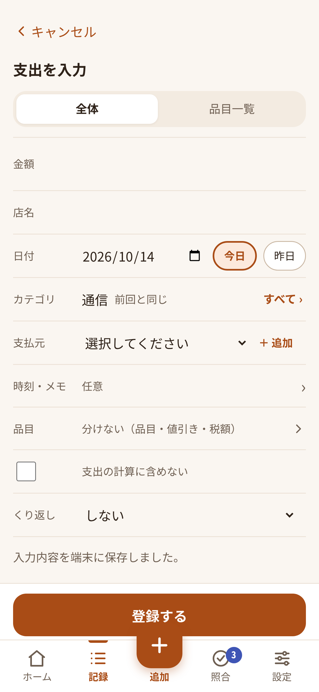 | 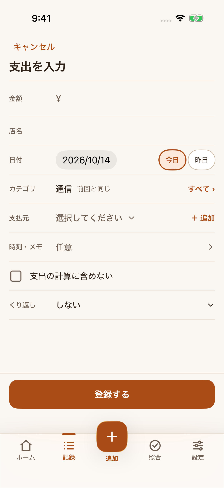 | 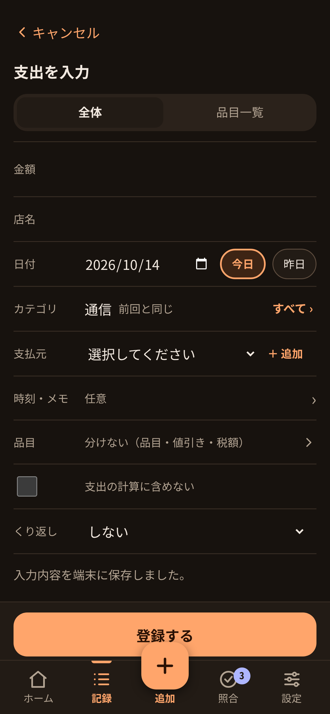 | 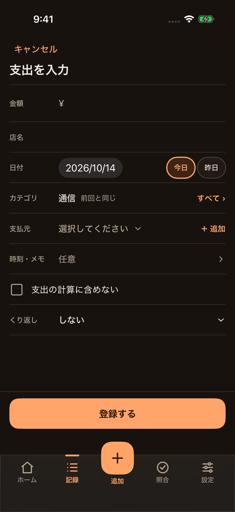 |
| 収入 | 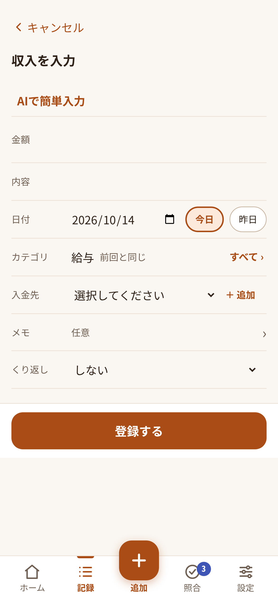 | 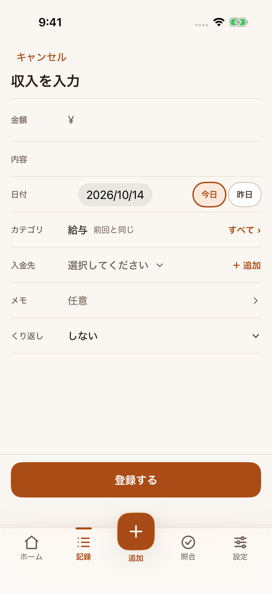 | 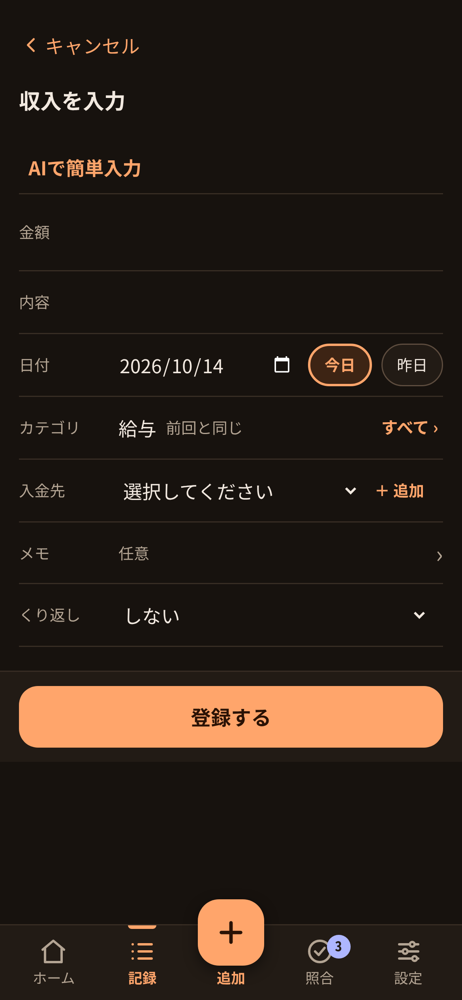 | 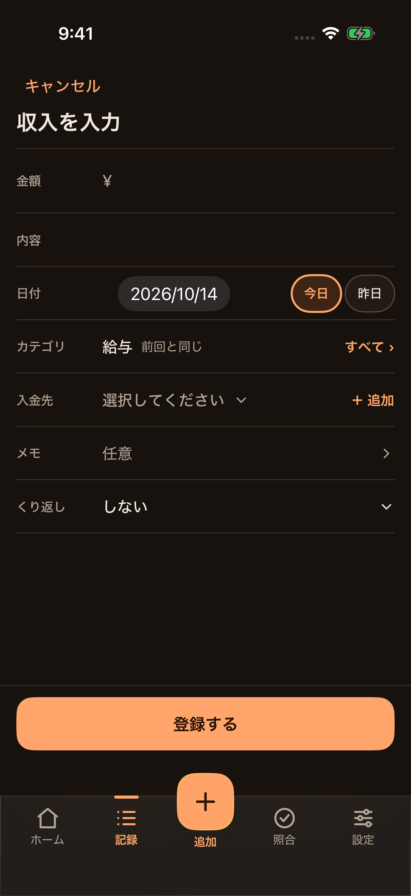 |
| 振替 | 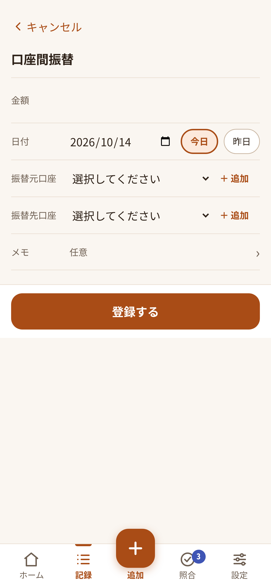 | 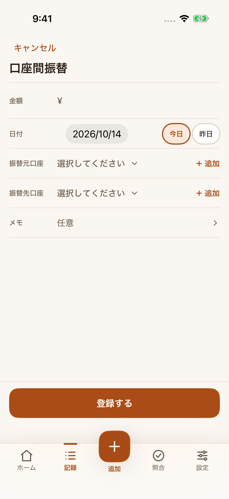 | 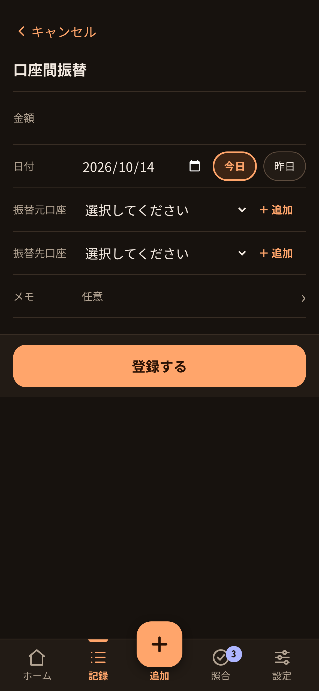 | 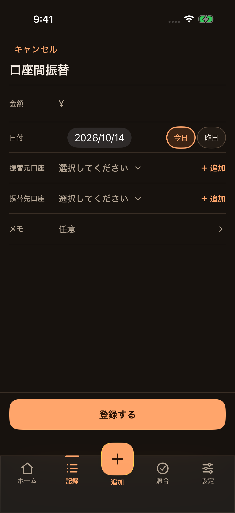 |
| カテゴリ選択 | 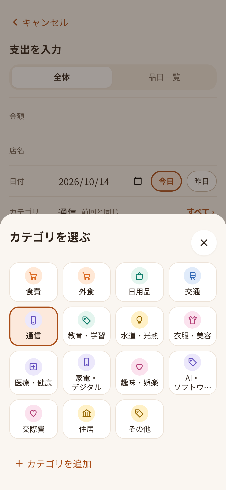 | 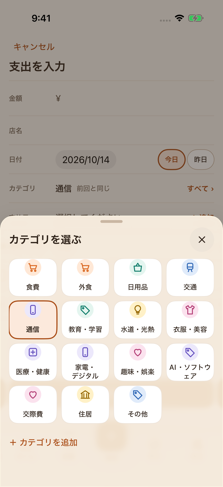 | 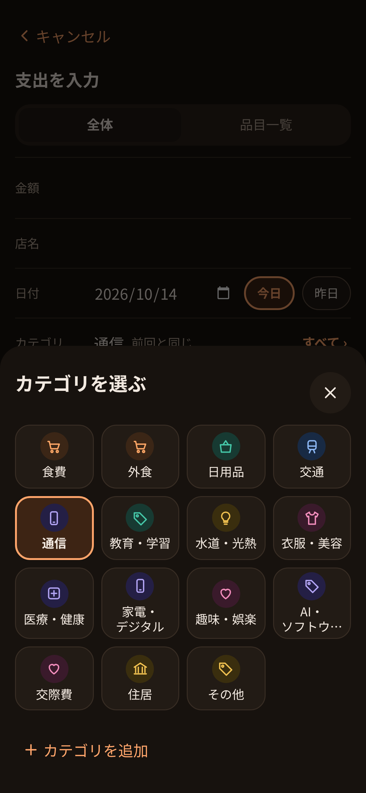 | 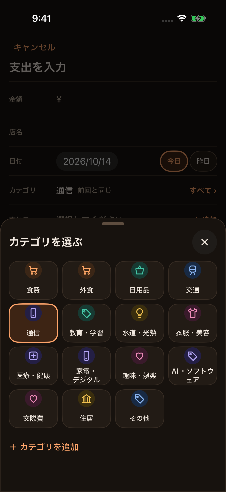 |
| 毎月の繰り返し | 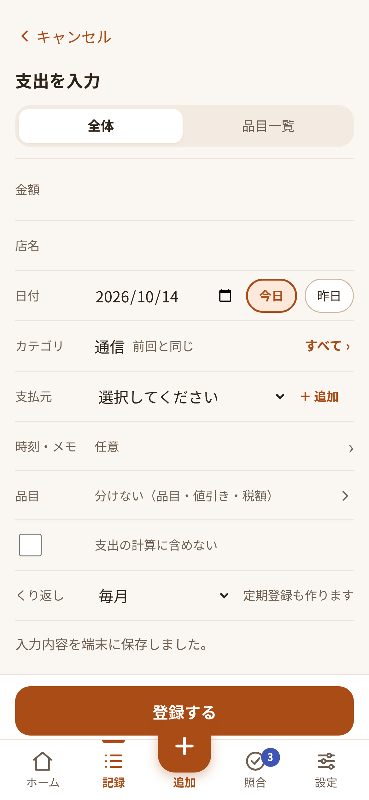 | 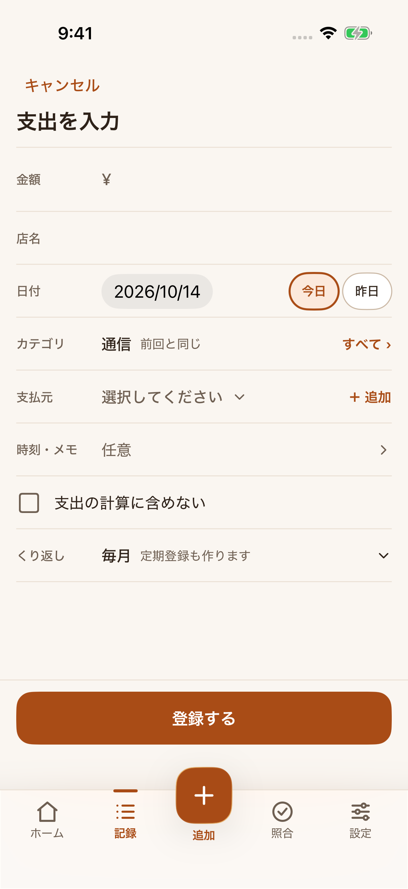 | 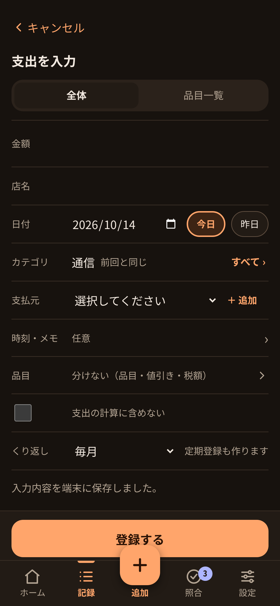 | 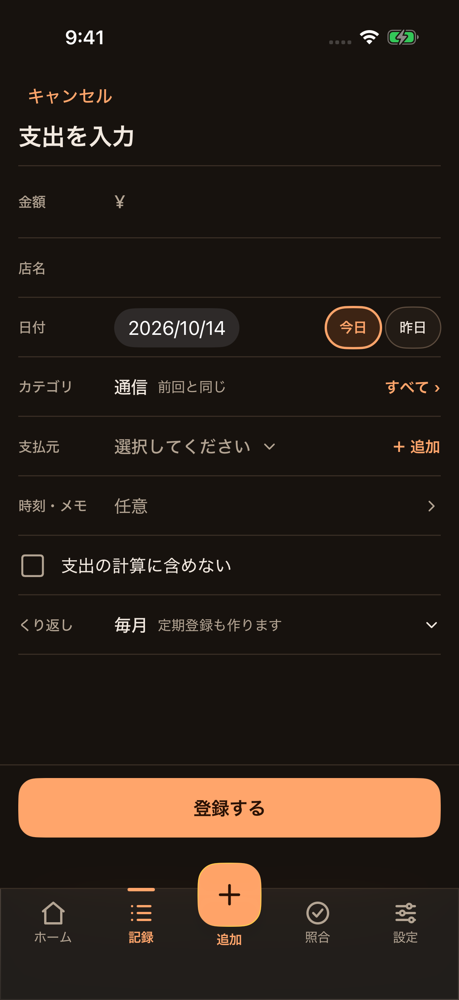 |

## 差分の分類

- **実装した入力:** 支出・収入・振替の基本項目、カテゴリ・口座の選択、日付の今日/昨日操作、任意のメモ、支出除外、繰り返し設定、登録ボタンを実装しました。入力画面ではPWAと同じく「記録」タブを選択します。カテゴリと口座の追加、定期登録も既存のRepository操作へ接続しています。
- **iOSで異なる表示:** 日付はiOSのコンパクトな日付選択、カテゴリは下から開くシート、繰り返しはOSメニューを使います。下部ナビとステータスバーもiOSの領域です。
- **PWAとの差・今回未実装:** PWAの支出入力は「全体／品目一覧」タブと「品目」行を表示します。iOS版は全体の入力だけで、品目の分割・編集画面を実装していません。PWAの収入入力にある「AIで簡単入力」も、iOS側の給与明細撮影・解析APIが未接続のため表示していません。
- **入力途中の保存:** PWAは支出・収入の入力途中の内容を端末へ保存し、画面を離れても再開できます。iOS版は登録前の下書きを保存しないため、キャンセルやタブ移動で入力が失われます。現在のRepositoryには、種類をまたぐ手入力下書きの保存・再取得と、保存結果が不明な場合の同一登録IDでの確認・再試行操作がありません。このPRでは画面側に代替保存を実装せず、Repository/APIの要望として報告します。
- **仕様文書との不一致:** `docs/UX.md` は振替元・振替先の「入替」操作を記載していますが、基準タグのPWAコードと振替画像にはありません。PWAを正解とする移行ルールに従い、iOS版にも表示しません。仕様を揃えるには、PWAと仕様文書のどちらを更新するか別途判断が必要です。
- **保存の検証:** `EntryFlowTests` はライト・ダークで支出・収入・振替画面を表示し、ライト表示では3種類それぞれを登録して「登録しました。」を確認します。保存結果の不明状態や下書きの復元は未検証です。

## Home画面の下端確認

[`../home/home-bottom-light.png`](../home/home-bottom-light.png) と [`../home/home-bottom-dark.png`](../home/home-bottom-dark.png) は、最後の記録までスクロールした状態です。`HomeBottomInsetTests` は両外観で最後の記録と下部ナビの間隔を確認し、間隔が0pt以上48pt以下であることを検証します。実測は既存の32pt余白の範囲内で、#295・#300適用後の二重余白は確認されなかったため、余白修正の別PRは作りません。

## 再撮影

リポジトリ直下でXcodeプロジェクトを生成し、専用のDerivedData（ビルド生成物の保存先）と結果バンドルを指定します。

```sh
cd apps/ios && xcodegen generate && cd ../..
xcodebuild -project apps/ios/KakeiMatch.xcodeproj -scheme KakeiMatch \
  -destination 'platform=iOS Simulator,id=AB556D29-AF1D-4D66-A56B-D6A770C552E3' \
  -derivedDataPath /tmp/KakeiMatch-Entry-DerivedData \
  -resultBundlePath /tmp/KakeiMatch-EntryScreenshots.xcresult \
  -parallel-testing-enabled NO \
  -only-testing:KakeiMatchUITests/EntryFlowTests \
  test CODE_SIGNING_ALLOWED=NO
xcrun xcresulttool export attachments \
  --path /tmp/KakeiMatch-EntryScreenshots.xcresult \
  --output-path /tmp/KakeiMatch-entry-attachments
```

出力された `manifest.json` で `suggestedHumanReadableName` と `exportedFileName` を照合してPNGを配置します。
