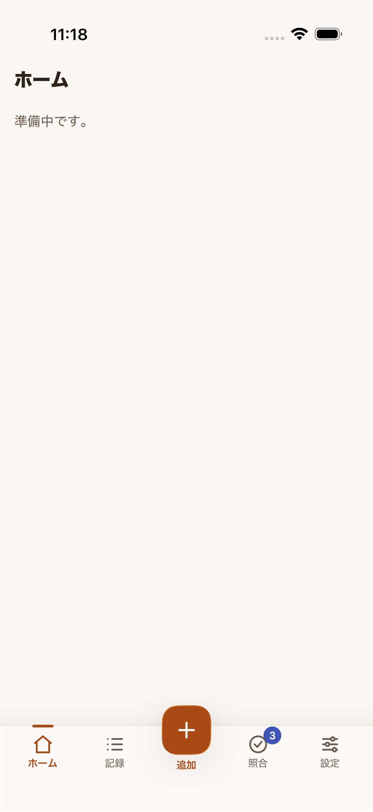
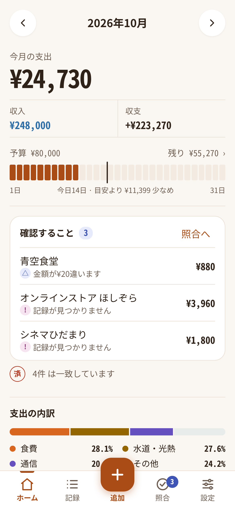
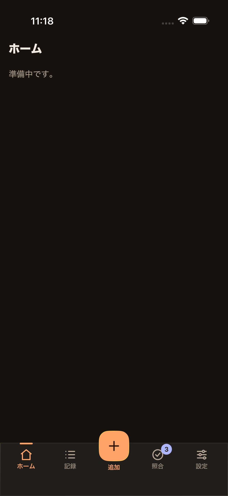
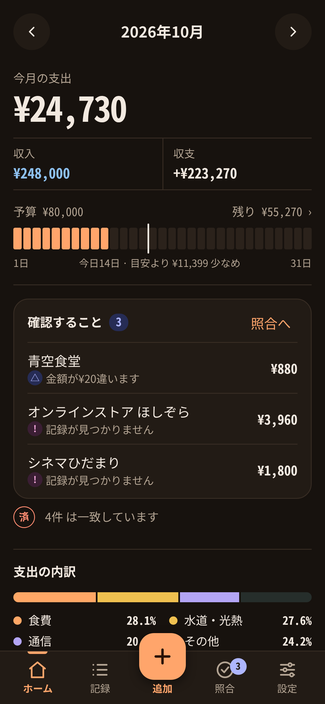

# iOS 共通shellの照合バッジ

XCUITestで `reconciliation` fixture（要確認1件・記録なし2件）を起動して撮影した、照合バッジ付きshellです。照合バッジは合計3件を表示し、読み上げ名も「照合（確認が必要 3件）」になります。

| iOS shell | PWA home / attention 基準 |
|---|---|
|  |  |
|  |  |

PWA画像はホームの注意欄を含む基準画面です。iOS画像はこのPRの対象である共通shellのナビゲーション表示を確認するもので、Home画面の内容が実装済みであることを示す比較ではありません。
